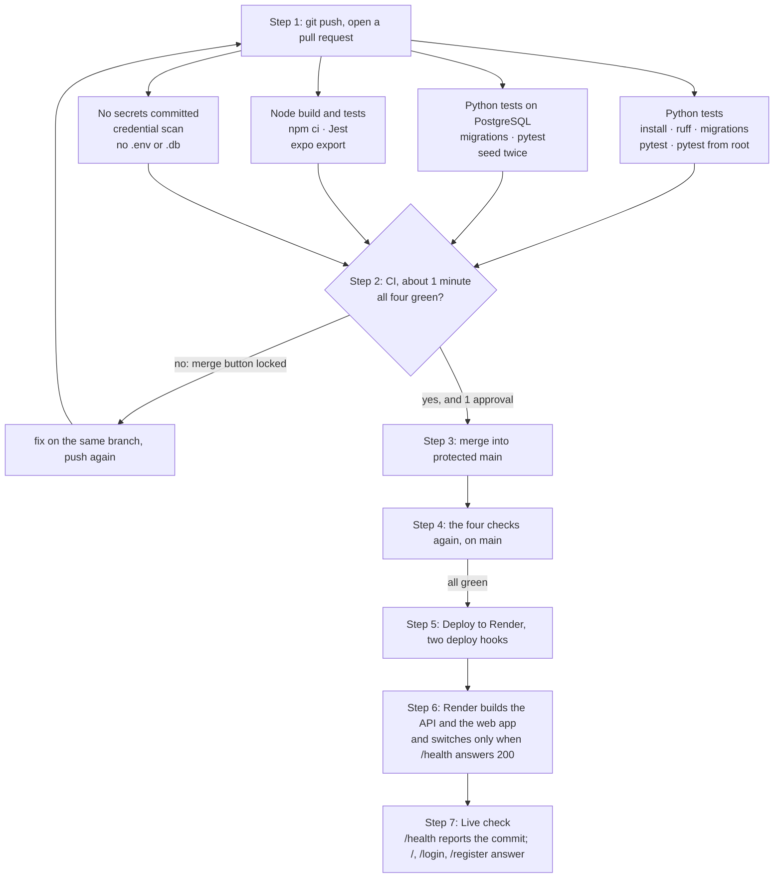
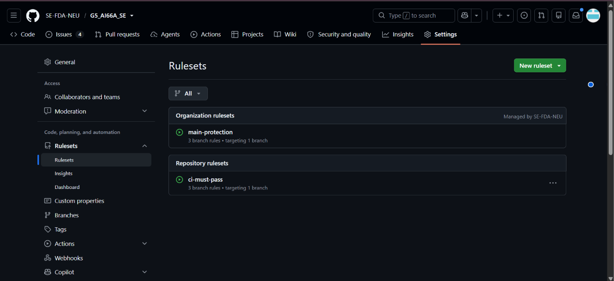

# Operations — Personal Expense Management App

How the app runs on the internet, how a change reaches it, how we watch it and how someone else
could look after it. Team 05 (G5_AI66A), Sprint 5.

## 1. How to run and release

| What | Where |
| --- | --- |
| The app, for everyone | **https://g5-expense-web.onrender.com** |
| The API and its documentation | https://g5-expense-api.onrender.com · https://g5-expense-api.onrender.com/docs |
| Health | https://g5-expense-api.onrender.com/health |
| Platform | Render, free plan: a Web Service for the API, a Static Site for the web app |
| Database | PostgreSQL 16 on Neon, free plan (ADR 4, `docs/design.md`) |
| Test account | `mai@example.com` / `demo1234`, a test value seeded at start-up, never a real password |

**How a new version gets there.** Nobody copies files to a server. A merge into `main` is a release:

1. A pull request is opened; CI runs its four check jobs; a teammate approves it through
   **Review changes**. The ruleset on `main` keeps the merge button locked until both happen.
2. The merge pushes to `main`, and CI runs again on the merged code.
3. Only if all four checks pass, the job **Deploy to Render** calls the two deploy hooks.
4. Render builds the API (`pip install -r requirements.txt`) and starts it with
   `python -m scripts.start`: migrations, demo data if missing, then uvicorn on `$PORT`. It sends
   traffic to the new version only once its `/health` answers 200; until then the old one answers.
   In parallel it builds the web app (`npm ci && npm run build`) and publishes `mobile/dist`.
5. The workflow **Live check** waits until `/health` reports the new commit, then opens `/`,
   `/login` and `/register`.

**Render settings**, so the services can be rebuilt by someone who has never seen them:

| Service | Setting | Value |
| --- | --- | --- |
| API, Web Service | Root directory · Build · Start | `backend` · `pip install -r requirements.txt` · `python -m scripts.start` |
| | Health check path · Auto-Deploy | `/health` · **Off** (CI deploys through the hook) |
| | Environment | `ENVIRONMENT=production`, `DATABASE_URL` (Neon), `SECRET_KEY` (random, 64 hex), `CORS_ORIGINS=https://g5-expense-web.onrender.com`, `PYTHON_VERSION=3.12.12` |
| Web, Static Site | Root directory · Build · Publish | `mobile` · `npm ci && npm run build` · `dist` |
| | Rewrite · Auto-Deploy | `/*` → `/index.html` · **Off** |
| | Environment | `EXPO_PUBLIC_API_URL=https://g5-expense-api.onrender.com/api`, `NODE_VERSION=22` |
| GitHub | Secrets · Variables | `RENDER_DEPLOY_HOOK_API`, `RENDER_DEPLOY_HOOK_WEB` · `API_URL`, `APP_URL` |

**Rolling back.** If a release breaks something:

1. **At once:** Render → the service → *Events* → the last good deploy → **Rollback**. The URL runs
   the old commit again within a minute. Do it for the API and the web app separately.
2. **Then, for good:** open a pull request that `git revert`s the merge, let CI pass and merge it.
   CI deploys the reverted code, so `main` and the URL agree again. Until then `/health` reports
   the old commit while `main` has the new one, which is how anyone can tell a rollback is in place.

A release that cannot reach the database never goes live: its `/health` answers 503, and Render
keeps the previous version.

## 2. The CI pipeline



| Job · step | What it checks | Time |
| --- | --- | --- |
| **Python tests** · install | `requirements-dev.txt` installs on a clean Python 3.12, from the pip cache | ~5 s |
| · Lint | `ruff check`: style and errors, before any test runs (fail fast) | 1 s |
| · Migrations match the models | `alembic upgrade head` then `alembic check` on a new SQLite file | 2 s |
| · Test | every pytest test, with coverage; the count goes to the run's summary | ~10 s |
| · One command from the root | `pytest` from the clone's root finds every test, as `docs/SETUP.md` says | ~10 s |
| **Python tests on PostgreSQL** | the migrations up and down, every test and the seed on a real PostgreSQL 16, as on the URL | ~40 s |
| **Node build and tests** | `npm ci` from the lock file, 101 Jest tests, and the web build Render runs | ~35 s |
| **No secrets committed** | no key, token, Neon password, `.env` or database file in the history | ~5 s |
| **Deploy to Render** | push to `main` only, after the four above: calls the deploy hooks | ~5 s |

The jobs run side by side, so a run takes as long as its slowest job: **about one minute** (median
46 s on `main` in Sprint 4, longest 115 s since Sprint 2), under the two to three minutes the week
13 lecture sets. Each check job stops after **3 minutes**, so a hung test turns red rather than
keeping a pull request waiting. A newer push cancels the run still going on the same branch.

Latest green run on `main`: https://github.com/SE-FDA-NEU/G5_AI66A_SE/actions/runs/42662453565.

`main` is protected by two rulesets (Settings → Rules): a pull request with one approval, and the
checks *Python tests*, *Python tests on PostgreSQL*, *Node build and tests* and *No secrets
committed* green. Force pushes and deleting `main` are blocked.



**How fast and how safely we ship**, measured from our own history (`git log --merges`, the
Actions tab), the four DORA metrics of week 13:

| Sprint | Deploy frequency (merges into `main` per week) | Lead time (PR opened → merged, median) | Change failure rate (runs on `main` that went red) | Time to restore |
| --- | --- | --- | --- | --- |
| 1 | 8.0 | 6.2 h | 0 of 16 | — |
| 2 | 8.5 | 1.1 h | 0 of 17 | — |
| 3 | 10.5 | 3.4 h | 0 of 21 | — |
| 4 | 11.0 | 0.5 h | 0 of 22 | — |
| 5 | Pending — Sprint 5 ends 16/11 | Pending — Sprint 5 ends 16/11 | Pending — Sprint 5 ends 16/11 | Pending — Sprint 5 ends 16/11 |

`main` has never been red, because a red pull request cannot be merged. Our failures happen on
branches, where they cost nobody else anything.

## 3. Monitoring

**What the app logs.** One line per request, written by `app/core/request_log.py`:

```
2026-11-09 10:12:03 INFO app.requests POST /api/auth/login 200 263ms
2026-11-09 10:12:04 WARNING app.requests GET /api/stats/months 200 1240ms
```

the method, the path without its query string, the status and the time. A crash adds its stack
trace. At start-up, the database address without its password and the row counts.

**What it never logs.** Request bodies (a sign-in body holds the password), headers (the
`Authorization` header holds the token), query strings, email addresses and the values sent with a
query: SQLAlchemy is told to hide them (`hide_parameters`), and uvicorn's own access log is off.
TC-81 fails if a password or an email reaches the log.

**Where to read it.** Render → the API service → *Logs*, searchable, kept for 7 days on the free
plan. The Actions tab keeps every CI, deploy and live-check run.

**What `/health` checks.** That the API runs and the database answers `SELECT 1`, within 3 seconds
per attempt: 200 with `{"status":"ok","database":"ok","version":"<commit>"}`, or 503 with
`"database":"unreachable"`. Render calls it before switching to a new version.

**The two numbers we watch.**

| Number | Healthy | How we would notice it going bad |
| --- | --- | --- |
| Error rate: share of requests answered 5xx | 0; any 500 is a bug to open | search the Render log for ` 500 `; a 503 from `/health` fails the Live check, and GitHub emails whoever merged |
| Response time | under 300 ms; a sign-in takes longer on purpose (PBKDF2, BR2) | a request over `SLOW_REQUEST_MS` (1000 ms) is logged as `WARNING`; search the log for it |

The Live check also runs every morning at 08:00 Vietnam time, so the URL going down between two
merges is noticed the same day, not by the instructor.

## 4. Known risks and technical debt

| Item | Layer | What could happen | Plan |
| --- | --- | --- | --- |
| The free API sleeps after 15 minutes idle | infrastructure | The first visit waits about a minute; someone thinks the app is down | Accepted: allowed by the brief; we open the URL five minutes before the demo |
| Neon's free plan has no backup we control | data | A mistake or the end of the free plan loses every account | #213: `pg_dump` weekly and before the demo, kept outside Git (section 5) |
| The demo account is made again in a new month | data | What a visitor added to `mai@example.com` in an earlier month disappears at the next start | Accepted: it is a shared test account, and the overview must never open empty (TC-85, TC-86) |
| SQLite on laptops, PostgreSQL on the URL | tests | A query that works on one fails on the other | Accepted: CI runs every test on both; it already caught the `VARCHAR` difference |
| Metro caches `EXPO_PUBLIC_API_URL` between builds | infrastructure | A changed API address is ignored and the web app calls the old one | Fixed: `npm run build` clears the cache (`--clear`); Render builds on a clean machine |
| Render settings live in its dashboard, not in Git | docs | A setting changed by hand is lost or never explained | Section 1 lists every setting; anyone changing one updates it in the same pull request |
| Profile pictures are kept in the database | data | Many large pictures fill Neon's free 0.5 GB | Accepted: BR15 caps one at 200 KB and the app sends about 20 KB; 1,000 accounts take under 20 MB |
| US07, US08 and US09 are not built | code | A user cannot cap spending or be warned before the cap | Accepted: P1 and P2, after every P0 story; they stay open on the board |

## 5. Maintenance plan

| Area | What to do | Owner | How often |
| --- | --- | --- | --- |
| Bugs | Each bug becomes an issue with the `bug` label and a failing test first, as #142 did; fixed through a pull request | @Chidokato5376 triages, the owner of the file fixes | Within the sprint it is found |
| Dependency updates | `pip list --outdated` and `npm outdated`; bump the pins in one pull request, CI decides; Dependabot alerts on GitHub are read | @levanduc36 | Monthly, and at once for a security alert |
| Backups of the data | `pg_dump "$DATABASE_URL" > g5-YYYYMMDD.sql`, kept on the team drive, never in Git; restore tried once on a fresh Neon branch | @nguyennhien2412 | Weekly, and before every demo |
| Monitoring | Read the failed-run emails of CI and the Live check; search the Render log for ` 500 ` and `WARNING` | @Chidokato5376 | Daily while the app is graded |
| Secrets | `SECRET_KEY`, the Neon password and both deploy hooks: rotate at once if one is ever seen in Git, a log or a chat | @Chidokato5376 | When one leaks, and at the end of the course |
| Keeping the docs true | A pull request that changes a behaviour, a setting or a command changes its line in `README.md`, `docs/SETUP.md` or this file; the reviewer checks it | the author, checked by the reviewer | Every pull request |

## 6. Lessons learned

Drafted from the retrospectives in `docs/retro.md` and confirmed at the Sprint 5 retrospective.

| Lesson | What happened | What we changed | What we would do differently |
| --- | --- | --- | --- |
| Merge a little every day | Sprints 2 and 4 ended with several pull requests merged on the last evening, after the day before slipped; reviews of those were the shortest of the sprint | Sprint 4 retro: "a pull request a day"; the review rotation is posted and requested automatically at planning | Cut issues small enough to merge within a day, and give each a merge-by date at planning |
| Fix a pull request, do not redo it | #129 was closed unmerged and redone as #131, 13.6 hours later; #137 reopened finished work and left card #93 stuck in *In Review* | Reviews ask for a change on the same branch; `board-in-review.yml` skips closed issues | Push the fix to the same branch: the review history and the board stay true |
| Deploy the walking skeleton, not the finished app | Going online in Sprint 5 found three things no laptop showed: SQLite is emptied on every deploy, PostgreSQL enforces `VARCHAR` lengths, and Metro keeps an old `EXPO_PUBLIC_API_URL` | ADR 4, a PostgreSQL job in CI, `--clear` in the build, `/health` that checks the database | Put the walking skeleton on a URL in Sprint 2, with deploy-after-green, so every sprint is tested where users are |
