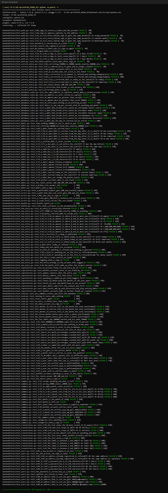

# Testing — Personal Expense Management App

**Team 05 · AI66A**
Milestone 4 · Sprint 4 · Weeks 11–12

Milestone 3 showed that people can use the app. This document shows that it keeps working when we
change it: every P0 story is checked by automated tests that run in about three seconds, with no
server and no real database, after every change and on every pull request.

**Run them all:** `pytest` in the cloned folder, with the virtual environment of
[docs/SETUP.md](SETUP.md) active (section 7 there). The tests live in
[`backend/tests/`](../backend/tests/); the app's own tests are in [`mobile/__tests__/`](../mobile/__tests__/).

---

## 1. What we test, and why

| Layer | Where | Test | Why |
| --- | --- | --- | --- |
| **Services** | `backend/app/services/` | Unit tests that call the service directly, with **today fixed** (12/11/2026 or 24/10/2026) and a database in memory | Every business rule lives here: BR1 to BR14. A mistake here is a wrong total or a refused entry, so this layer gets most tests, at both sides of every limit |
| **Repository** | `backend/app/db/repositories/`, the models and migrations | Tests on a database in memory (`test_repositories.py`), the table constraints written straight to the tables (`test_database_rules.py`), and the seed script on a temporary file (`test_seed.py`) | Checks the SQL: which rows a query finds, that every query keeps to one account (BR4), and that BR1, BR5, BR7 and BR13 hold even if an endpoint forgets them. CI also runs `alembic check` |
| **Routes** | `backend/app/routers/`, `backend/app/core/` | A few tests per route with FastAPI's `TestClient`, in-process: no port, no server | Only that each route answers the right status and error code, `{"detail", "code"}`, and refuses without a sign-in. The rules behind them are already tested on the services |
| **Interface** | `mobile/src/` | Jest tests (`npm test`, 101 tests) for the pure functions only: amounts, dates, the entry form, chart scaling, debt dates, the dictionaries and the routes. **No screen is tested automatically** | The screens were checked by real users in M3 and change every sprint; a screenshot test would break on every change of spacing. What a screen shows comes from the API, which is tested above |

**Where the risk is, and why we tested it most.** We tested most where a mistake costs money or
trust and where the code is new: the money rules (BR5 on entries, corrections and debts; BR11 dates;
the month totals of US04) and the sign-in rules (BR3, BR10), because a wrong total or a wrong
"Incorrect email or password" makes the app useless, and the debt rules of US13 (BR13, BR14),
because they are new this sprint and have three limits each. Every number in a rule, 6 and 128
characters, 7 days, today, 20 entries, one trillion dong, 60 characters, a due date, has a test on
each side of it. The language switch and the screen layouts are tested least: a mistake there is
visible at once and cheap to fix.

**Why a database in memory, not a fake repository.** Our services call the repository module
functions directly (`transaction_repo.month_totals(db, ...)`), so a fake would mean rewriting every
service to take its repository as a parameter. SQLite in memory is as fast as a fake, about 0.01
second per test, and it also runs the real SQL, which a fake would not. Each test gets its own empty
database from `backend/tests/conftest.py`, so tests never touch `backend/expense.db` and never
affect one another.

---

## 2. Test cases for every P0 story

Each ID is a pytest test, or one row of a parametrised test, named with the ID (section 3). The
expected results come from the acceptance criteria and the rules in `docs/requirements.md`, never
from what the code happened to answer. Where a criterion depends on today, the test fixes today, as
the criterion does.

**Kind:** *normal* the criterion succeeds · *error* a rule refuses the input · *boundary* a value
just below, on, or just above a number in a rule.

### 2.1 US01 — Create an account (BR1, BR2) · `test_users.py`

| ID | Story | Input | Expected result | Kind |
| --- | --- | --- | --- | --- |
| TC-01 | US01 | `hoa@example.com`, password `abcd1234` (8 characters), no account yet | 201 with a token; `GET /api/auth/me` with it answers 200 at once: no second sign-in | normal |
| TC-02 | US01 | `mai@example.com`, already registered | 409 "This email is already registered"; still one account | error |
| TC-03 | US01 | `MAI@EXAMPLE.COM`, the same address in capitals | 409, the same message; still one account (BR1) | error |
| TC-04 | US01 | a password of 5 characters | 422 "Password must be 6 to 128 characters"; no account | boundary, just below 6 |
| TC-05 | US01 | a password of 6 characters | 201, account created | boundary, on 6 |
| TC-06 | US01 | a password of 128 characters | 201, account created | boundary, on 128 |
| TC-07 | US01 | a password of 129 characters | 422 "Password must be 6 to 128 characters"; no account | boundary, just above 128 |
| TC-08 | US01 | `hoa`, `hoa@example`, `@example.com`, `hoa @example.com` | 400 "Enter a valid email address"; no account | error |

### 2.2 US02 — Sign in and stay signed in (BR3, BR10) · `test_auth.py`

| ID | Story | Input | Expected result | Kind |
| --- | --- | --- | --- | --- |
| TC-09 | US02 | `mai@example.com` with `demo1234` | 200, a token and the account `{id, email}` | normal |
| TC-10 | US02 | `MAI@Example.COM` with `demo1234` | 200: capitals do not make another account (BR1) | normal |
| TC-11 | US02 | the right email, a wrong password | 401 "Incorrect email or password", code `incorrect_sign_in` | error |
| TC-12 | US02 | `ghost@example.com`, never registered | the identical 401 answer as TC-11 (BR3) | error |
| TC-13 | US02 | `not-an-email` | the identical 401 answer, not a 400 that would say the address was the problem (BR3) | error |
| TC-14 | US02 | a sign-in 6 days 23 hours 59 minutes ago | `GET /api/auth/me` 200: still signed in | boundary, just below 7 days |
| TC-15 | US02 | a sign-in exactly 7 days ago | 401 "Please sign in again": the session has ended | boundary, on 7 days |
| TC-16 | US02 | a sign-in 7 days and 1 minute ago | 401 "Please sign in again" | boundary, just above 7 days |

### 2.3 US03 — Log a purchase in seconds (BR5, BR6, BR11) · `test_new_entry.py`

Today is 12/11/2026 for TC-27 to TC-29, as in the criterion.

| ID | Story | Input | Expected result | Kind |
| --- | --- | --- | --- | --- |
| TC-17 | US03 | 55,000 spent, note "tra sua", Food | 201; the month's spending grows by exactly 55,000; the entry is listed under Food | normal |
| TC-18 | US03 | 4,000,000 received, Salary | income grows by exactly 4,000,000; spending does not change | normal |
| TC-19 | US03 | the amount left empty | 422 "Enter an amount greater than 0"; nothing stored | error |
| TC-20 | US03 | 0 | 422 "Enter an amount greater than 0"; nothing stored | boundary, just below the lower limit |
| TC-21 | US03 | 1 | 201: the smallest amount | boundary, on the lower limit |
| TC-22 | US03 | −20,000 | 422 "Enter an amount greater than 0"; nothing stored | error |
| TC-23 | US03 | 55,000.50 | 400 `invalid_request`: VND has no subunit; nothing stored | error |
| TC-24 | US03 | 1,000,000,000,000 | 201 | boundary, on the upper limit |
| TC-25 | US03 | 1,000,000,000,001 | 422 "Enter an amount of at most 1,000,000,000,000"; nothing stored | boundary, just above the upper limit |
| TC-26 | US03 | 9,223,372,036,854,775,808; then the month after two entries of 1,000,000,000,000 and one refused of 9,223,372,036,854,775,807 | 422, never 500; `GET /api/summary` answers 200 with 2,000,000,000,000 spent | error, the regression test of bug #142 |
| TC-27 | US03 | dated 12/11/2026, today | stored | boundary, on today |
| TC-28 | US03 | dated 13/11/2026, tomorrow | 422 "The date cannot be in the future"; nothing stored | boundary, just above today |
| TC-29 | US03 | dated 28/10/2026, last month | stored: a purchase written down late still counts | normal |
| TC-30 | US03 | kind of spending 999, not on the list; or Salary for money spent | 422 "Choose a kind of spending from the list"; nothing stored | error |

### 2.4 US04 — This month's position (BR4) · `test_summary.py`

| ID | Story | Input | Expected result | Kind |
| --- | --- | --- | --- | --- |
| TC-31 | US04 | 4,000,000 received; 55,000 and 150,000 spent this month | 200: income 4,000,000, spending 205,000, remaining 3,795,000 | normal |
| TC-32 | US04 | 3,795,000 left, then an entry of 30,000 saved | remaining 3,765,000, with no further step | normal |
| TC-33 | US04 | no entries this month | count 0, which the app shows as "No transactions yet this month" | normal |
| TC-34 | US04 | an entry on 31/10/2026, month 11/2026 | not counted in 11/2026 | boundary, the day before the month |
| TC-35 | US04 | an entry on 01/11/2026 | counted | boundary, the first day |
| TC-36 | US04 | an entry on 30/11/2026; another on 01/12/2026 | the first counted, the second not | boundary, the last day and the day after |
| TC-37 | US04 | month `11/2026`, `2026-13`, `2026-1` | 400 "Month must be written YYYY-MM" | error |
| TC-38 | US04 | another account received 9,000,000 this month | this account's income stays 0 (BR4) | error |

### 2.5 US05 — Look back over recent entries (BR4) · `test_transactions.py`

| ID | Story | Input | Expected result | Kind |
| --- | --- | --- | --- | --- |
| TC-39 | US05 | 25 entries | 200: the 20 most recent, newest first; total 25 | normal |
| TC-40 | US05 | exactly 20 entries | all 20 shown | boundary, on 20 |
| TC-41 | US05 | 21 entries | 20 shown, the oldest left out; total 21 | boundary, just above 20 |
| TC-42 | US05 | one entry | the row has its amount, note, kind of spending and date | normal |
| TC-43 | US05 | another account has 3 entries, this one 2 | only this account's 2 (BR4) | error |
| TC-44 | US05 | no sign-in | 401 "Please sign in again" | error |
| TC-45 | US05 | `limit` 0, 1, 100, 101 | 400, 200, 200, 400 | boundary, both edges of 1 to 100 |

Criterion 2 of US05, "No connection. Tap Refresh to try again" with the old entries kept, happens
in the app when there is no network at all. It is checked by the Jest test of `describeError` in
`mobile/__tests__/i18n.test.js` and by hand (`docs/ui.md`, section 2), not by pytest: the backend
cannot be the one that is unreachable.

### 2.6 The stories built in Sprint 4

Not required for M4, but tested the same way, because they are the newest code.

| ID | Story | Input | Expected result | Kind |
| --- | --- | --- | --- | --- |
| TC-46 | US06 | an entry of 150,000 corrected to 50,000 | the month's spending drops by exactly 100,000 | normal |
| TC-47 | US06 | Delete after "Delete this entry?" | the entry is gone and no longer counted | normal |
| TC-48 | US06 | another account's entry: read, correct, delete | 404 "Entry not found" each time; their entry unchanged (BR4) | error |
| TC-49 | US06 | id 999, which does not exist | 404, code `entry_not_found` | error |
| TC-50 | US06 | corrected to 0, or to no amount | 422 "Enter an amount greater than 0"; the entry still reads 150,000 | error |
| TC-51 | US06 | the date corrected to 12/11/2026, today | accepted | boundary, on today |
| TC-52 | US06 | the date corrected to 13/11/2026 | 422 "The date cannot be in the future"; the date unchanged | boundary, just above today |
| TC-53 | US10 | Food 3,000,000 and Transport 1,000,000 in 10/2026 | Food first at 75%, Transport 25% | normal |
| TC-54 | US10 | a month with no entries | total 0 and no lines: "No data yet this month" | normal |
| TC-55 | US10 | 4,000,000 Salary and 55,000 Food | only Food, at 100%: money received is not spending | normal |
| TC-56 | US10 | 60,000 Food and 40,000 with no kind chosen | a line of its own for no kind, 40% (BR6) | normal |
| TC-57 | US10 | shares 1/3, 2/3, 1/8, 1/200, 1/201 | 33, 67, 13, 1, 0: whole percentages, rounded half up | boundary, at 0.5 |
| TC-58 | US12 | 1,200,000 in 09/2026, 2,931,000 in 10/2026; today 24/10/2026 | twelve months; most spent 10/2026, least 09/2026 | normal |
| TC-59 | US12 | November and December 2026, after this month | 0, and never named the least spent (BR12) | boundary, after this month |
| TC-60 | US12 | 900,000 in both 02/2026 and 03/2026 | least spent is 02/2026, the earlier (BR12) | boundary, a tie |
| TC-61 | US12 | January with no entries, February with money received only | least spent is February, never January (BR12) | normal |
| TC-62 | US12 | entries on 31/12/2025 and 01/01/2026 | the first in 2025, the second in 2026 | boundary, the year's edge |
| TC-63 | US12 | year 2026, and year 2027 | 2026 shown; 2027 refused with "The year cannot be in the future" (BR12) | boundary, this year |
| TC-64 | US12 | year `26`, `20266`, `abcd` | 400 "Year must be written YYYY" | error |
| TC-65 | US12 | 2025, a year with no entries | every month 0 and none named: "No entries in this year" | normal |
| TC-66 | US13 | 200,000 lent to Lan, due in 10 days | "Owed to you" grows by exactly 200,000; the debt is open | normal |
| TC-67 | US13 | 500,000 borrowed from Minh, then settled | "You owe" drops by exactly 500,000 | normal |
| TC-68 | US13 | the same debt settled again | 409 "This debt is already settled"; the first settled date is kept (BR14) | error |
| TC-69 | US13 | open, due 23/10/2026; today 24/10/2026 | overdue | boundary, the day after the due date |
| TC-70 | US13 | open, due 24/10/2026 (today), 25/10/2026, or with no due date | not overdue (BR14) | boundary, on the due date |
| TC-71 | US13 | settled, past its due date | never overdue (BR14) | normal |
| TC-72 | US13 | started 24/10/2026, due 23/10/2026 | 422 "The due date cannot be before the start date"; nothing stored | boundary, just below the start |
| TC-73 | US13 | started and due 24/10/2026 | stored | boundary, on the start |
| TC-74 | US13 | a name of 0 characters, only spaces, 1, 60, and 61 characters | refused, refused, stored, stored, refused with "Write a name of 1 to 60 characters" (BR13) | boundary, both edges of 1 to 60 |
| TC-75 | US13 | amount empty, 0, −200,000, 1,000,000,000,001 | 422 from BR5; nothing stored | error |
| TC-76 | US13 | started 24/10/2026, and 25/10/2026 | stored; refused with "The date cannot be in the future" (BR11) | boundary, today |
| TC-77 | US13 | 200,000 lent and 500,000 borrowed this month | the month's income, spending and count stay 0: a debt is not spending | normal |
| TC-78 | US13 | another account's debt: settle, remove | 404 "Debt not found"; their debt unchanged (BR4) | error |

**Decision table, BR14: is this debt overdue?** The answer depends on three conditions together,
so each column is one test case.

| Condition / result | R1 | R2 | R3 | R4 |
| --- | --- | --- | --- | --- |
| Settled? | Y | N | N | N |
| Has a due date? | – | N | Y | Y |
| Is today after the due date? | – | – | N | Y |
| **Overdue** | **no** | **no** | **no** | **yes** |
| Test case | TC-71 | TC-70, no due date | TC-70, due today or later | TC-69 |

---

## 3. Automated tests

Every test case of section 2 is a pytest test in `backend/tests/`, with its ID in the test's name,
such as `test_tc14_to_tc16_a_sign_in_lasts_seven_days`, and in the name of each of its rows, such
as `[TC-15 7 days]`. One command runs them all, from the cloned folder:

```
pytest
```

`pytest -v` lists every test by name; `pytest -k tc26` runs one test case. The root `pytest.ini`
points pytest at `backend/tests/`, so the same command also works from `backend/`.

**No server, no real database.** `backend/tests/conftest.py` sets `DATABASE_URL` to a SQLite
database in memory before the app is imported, gives every test its own empty database, and calls
the routes through FastAPI's `TestClient`, in the same process. The seed script's tests use a file
in pytest's temporary folder. Nothing reads `backend/expense.db`, `backend/.env` or today's date
where a rule depends on it: the services take `today` as a parameter and the tests fix it. A fresh
clone passes on any day; CI proves it on every pull request by running `pytest` from the repository
root on a machine that has never seen the project (`.github/workflows/ci.yml`).

| File | Test cases | Stories | Written by |
| --- | --- | --- | --- |
| `test_users.py` | TC-01 to TC-08 | US01 | @levanduc36 |
| `test_auth.py` | TC-09 to TC-16 | US02 | @levanduc36 |
| `test_new_entry.py` | TC-17 to TC-30 | US03 | @levanduc36; the fix of bug #142 by @Chidokato5376 |
| `test_summary.py` | TC-31 to TC-38 | US04 | @levanduc36 (Sprint 3), test case IDs and month edges by @nguyennhien2412 |
| `test_transactions.py` | TC-39 to TC-45 | US05 | @levanduc36 (Sprint 2), test case IDs and the 20/21 edge by @vantran2801 |
| `test_correct_entry.py` | TC-46 to TC-52 | US06 | @Chidokato5376 |
| `test_stats.py` | TC-53 to TC-65 | US10, US12 | @Chidokato5376 |
| `test_debts.py` | TC-66 to TC-78 | US13 | @Chidokato5376 |
| `test_repositories.py` | the queries behind US04 to US13 | | @nguyennhien2412 |
| `test_database_rules.py`, `test_seed.py`, `test_errors.py`, `test_health.py` | the constraints, the demo data, the error shape | | @levanduc36, @nguyennhien2412 |

Each member wrote tests in `backend/tests/` this sprint; the author of a service wrote its unit
tests, and another member reviewed them in the pull request (`docs/process.md`, rule 6).

**Result:** 177 passed in about 3 seconds, on Python 3.12, Windows 11. The app's Jest tests:
`npm test` in `mobile/`, 101 passed.



---

## 4. What the tests found

**Bug #142 — a huge amount broke the month's totals for good.** Writing the test cases of US03, we
gave BR5 the partition every amount rule needs, "a very large amount", and it had no test. Steps: sign
in as `mai@example.com`, add an entry of 9,223,372,036,854,775,807 ₫, the largest number SQLite
stores, then any other entry this month. Expected: a message under the form, the overview unchanged.
Actual: the first entry was stored, and from then on `GET /api/summary` answered 500, because the
month's SUM no longer fits in 64 bits: `/` showed its error state for good. One dong more,
9,223,372,036,854,775,808, was refused with a 500 instead of a message.

**Fix.** The Product Owner gave BR5 an upper limit, at most 1,000,000,000,000 ₫ per entry
(`docs/changelog.md`, 26/10/2026): `transaction_service.check_amount` refuses more with "Enter an
amount of at most 1,000,000,000,000" (code `amount_too_large`), and debts follow the same check. At
that size a month needs over nine million entries before its sum could overflow. Fixed by the pull
request that closes #142.

**The tests that guard it now:** TC-24, TC-25 and TC-26, as regression tests. Without the fix, the
same tests are red:

```
$ pytest -k "tc19_to_tc26 or tc26_" backend/tests/test_new_entry.py
>       assert refused.status_code == 422
E       assert 201 == 422
FAILED tests/test_new_entry.py::test_tc19_to_tc26_...[TC-25 1,000,000,000,001]
FAILED tests/test_new_entry.py::test_tc19_to_tc26_...[TC-26 2^63]
FAILED tests/test_new_entry.py::test_tc26_the_month_still_adds_up_after_the_largest_entries
3 failed, 5 passed, 15 deselected in 0.26s
```

**A rule broken on purpose, BR14.** Before committing the tests of US13, we changed one character in
`debt_service.is_overdue`, `today > debt.due_on` to `today >= debt.due_on`, so a debt was overdue on
its due date itself. The boundary test went red at once, then we put the code back:

```
$ pytest -k tc69_tc70 backend/tests/test_debts.py
>       assert debts(db, account.id).items[0].overdue is overdue
E       assert True is False
FAILED tests/test_debts.py::test_tc69_tc70_...[TC-70 due today]
1 failed, 3 passed, 22 deselected in 0.15s
```

Every member broke one rule of their own the same way before opening their test pull request; the
pull requests say which line they changed.
