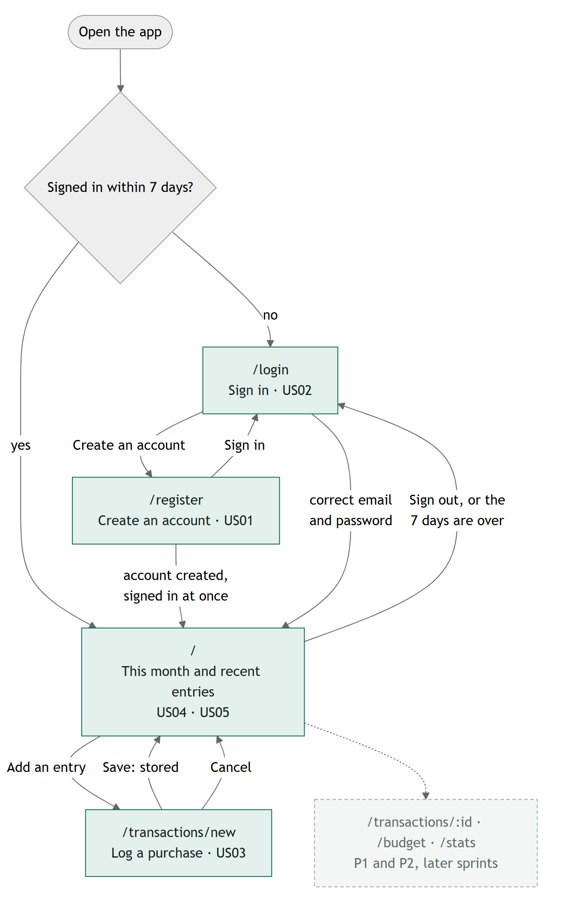
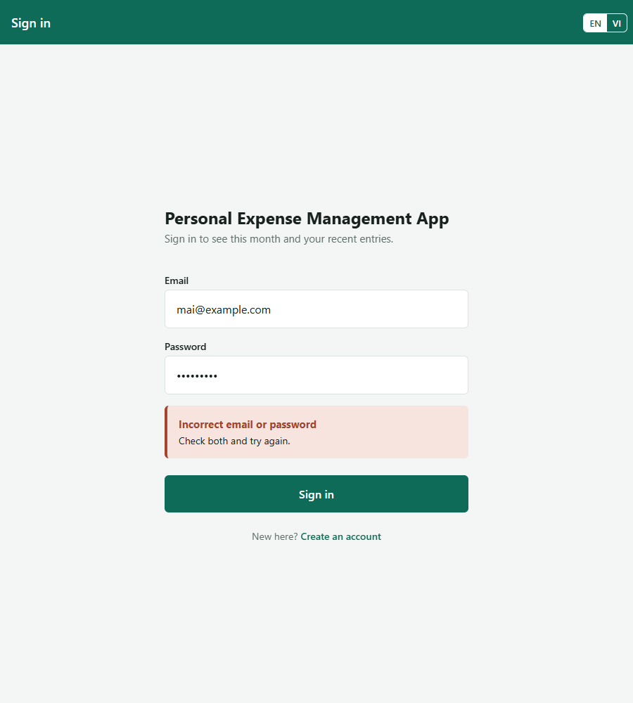
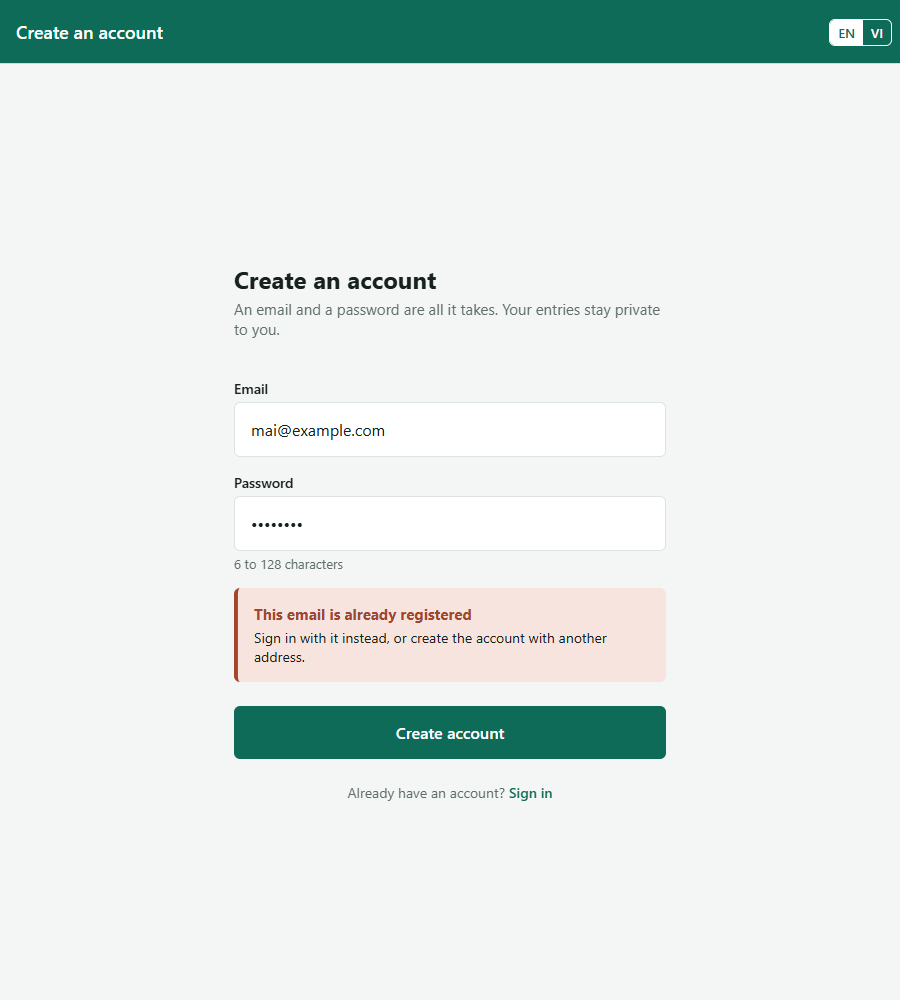
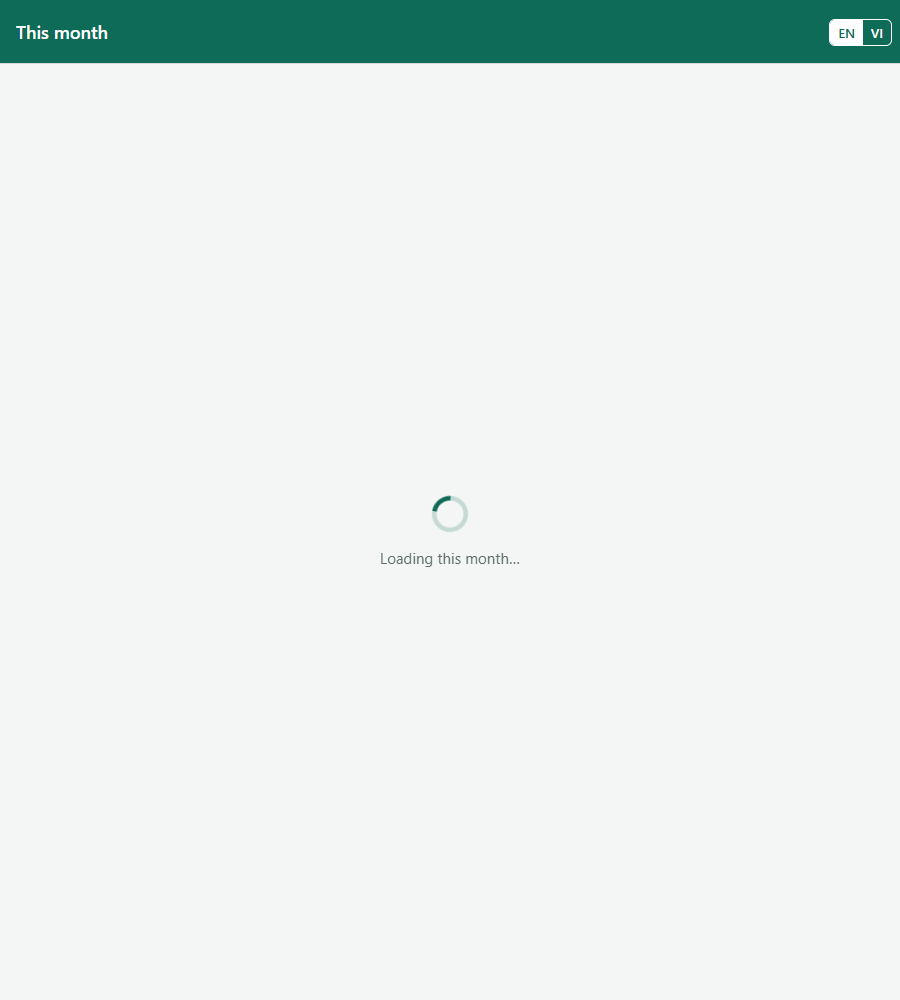
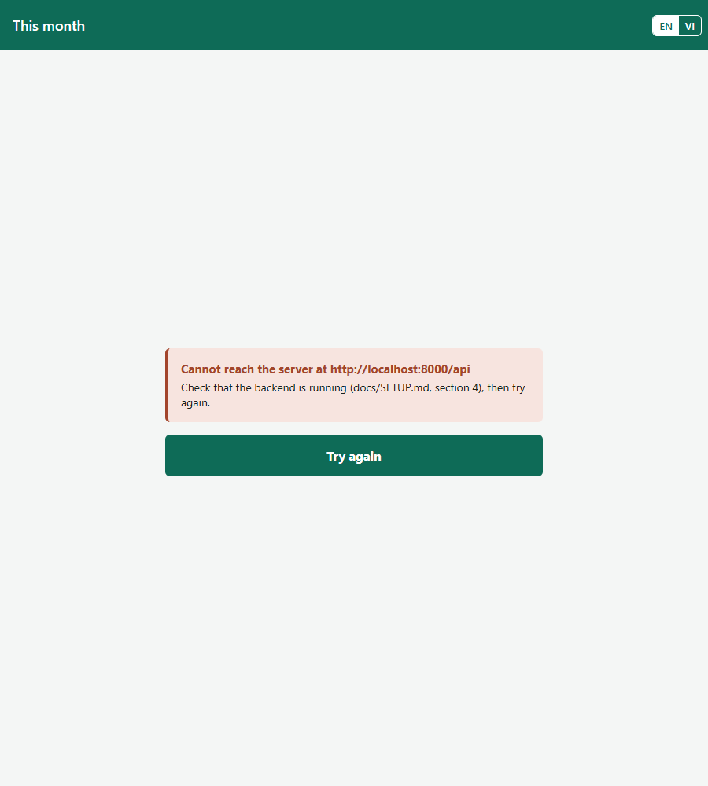
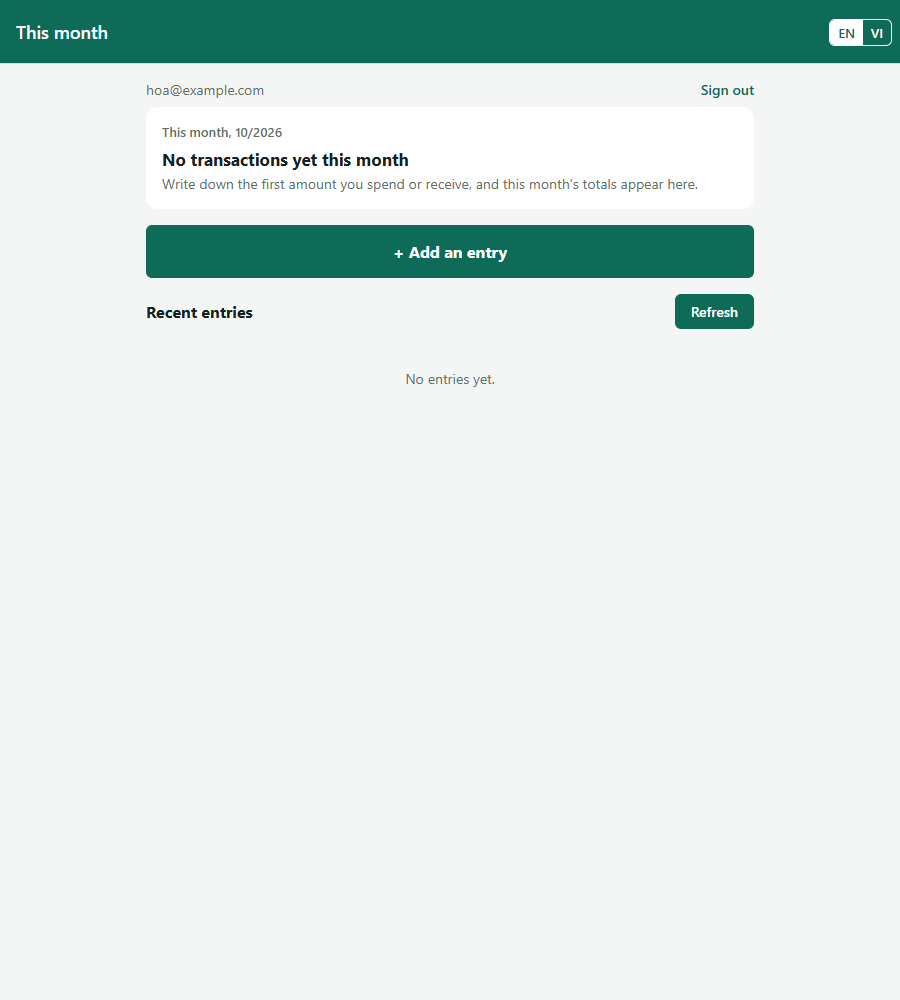
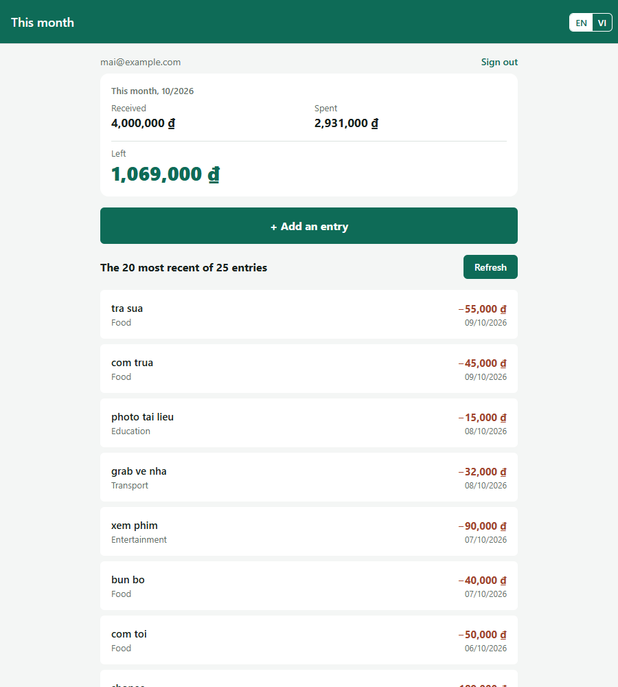
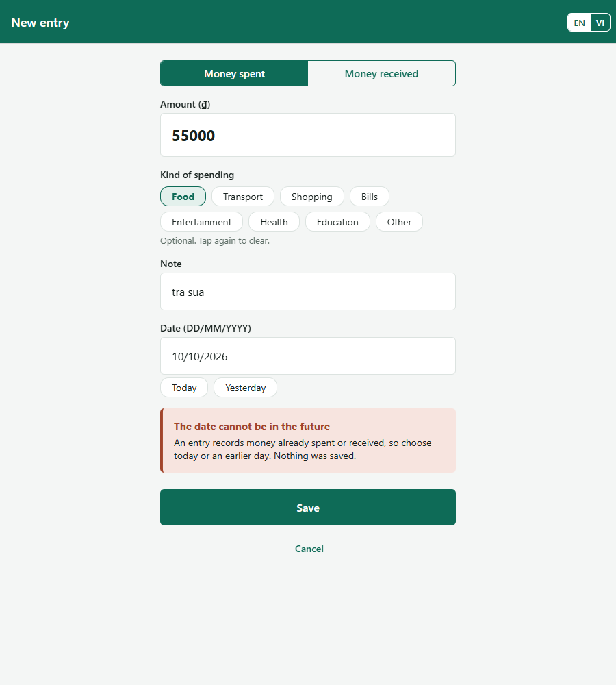

# User interface — Personal Expense Management App

**Team 05 · AI66A**
Milestone 3 · Sprint 3 · Weeks 9–10

How a person who has never seen the app completes every P0 story through its screens, with real
data from the database, and what they read when they break a rule. The stories are in
[`docs/requirements.md`](requirements.md), the API behind each screen in
[`docs/design.md`](design.md), and the steps to run it in [`docs/SETUP.md`](SETUP.md).

---

## 1. P0 stories and status

Every P0 story starts from a link or a button on a screen; no address has to be typed by hand. The
app opens on `/login` for someone signed out and on `/` for someone signed in within 7 days.

| Story | Screen(s) | Route | Status | Issue |
| --- | --- | --- | --- | --- |
| US01 Create an account | Create an account | `/register`, from **Create an account** on `/login` | not started | [#14] |
| US02 Sign in and stay signed in | Sign in | `/login` | works | [#15] |
| US03 Log a purchase in seconds | New entry | `/transactions/new`, from **+ Add an entry** on `/` | not started | [#16] |
| US04 This month's position | Overview | `/`, the card at the top | not started | [#17] |
| US05 Look back over recent entries | Overview | `/`, the list under the card | works | [#18] |

**Works** means a person can complete the story through the interface from a fresh clone, with
`docs/SETUP.md` and nothing else, and every acceptance criterion on the issue passes. US02 and US05
have worked since Sprint 2. US01, US03 and US04 are built this sprint, by #103 to #106 on the API of
#94 and #97 to #99, and tested by #100 and #101; their status changes as each one merges.

**The flow as built.** The M1 flow (`docs/images/flow.png`) planned seven screens. The four P0
screens below are built; the three P1 and P2 screens, dashed, come in later sprints. A broken rule
never leaves the screen: the message and what to do next appear under the form, and nothing is
stored.



Source of the diagram: [`docs/images/ui/flow.mmd`](images/ui/flow.mmd).

[#14]: https://github.com/SE-FDA-NEU/G5_AI66A_SE/issues/14
[#15]: https://github.com/SE-FDA-NEU/G5_AI66A_SE/issues/15
[#16]: https://github.com/SE-FDA-NEU/G5_AI66A_SE/issues/16
[#17]: https://github.com/SE-FDA-NEU/G5_AI66A_SE/issues/17
[#18]: https://github.com/SE-FDA-NEU/G5_AI66A_SE/issues/18

---

## 2. Wireframes

One wireframe per P0 screen, drawn before the screen was built. The overview at `/` is drawn in
all four states. Every screen has the language switch, **EN | VI**, at the right of its top bar
(US11), left out of the drawings below. Under each wireframe, a screenshot of the screen as built.

### `/login`, Sign in

"The user comes here to sign in once, and is then not asked again for 7 days."
Calls: `POST /api/auth/login`.

```
+- Sign in ---------------------------------------+
| Personal Expense Management App                 |
| Sign in to see this month and your recent       |
| entries.                                        |
|                                                 |
| Email     [ you@example.com                 ]   |
| Password  [ ********                        ]   |
|                                                 |
| ! Incorrect email or password                   |   <- only after a failed sign-in (BR3)
|   Check both and try again.                     |
|                                                 |
| [               Sign in                     ]   |
|          New here?  Create an account  ->       |   <- goes to /register
+-------------------------------------------------+
```

As built:



### `/register`, Create an account

"The user comes here to create an account with an email and a password, and lands on `/`
already signed in."
Calls: `POST /api/users`.

```
+- Create an account -----------------------------+
| Create an account                               |
| An email and a password are all it takes.       |
|                                                 |
| Email     [ hoa@example.com                 ]   |
| Password  [ ********                        ]   |
|           6 to 128 characters                   |
|                                                 |
| ! This email is already registered              |   <- 409 (BR1), 422 (BR2) or 400
|   Sign in with it instead, or create the        |
|   account with another address.                 |
|                                                 |
| [            Create account                 ]   |
|      Already have an account?  Sign in  ->      |   <- back to /login
+-------------------------------------------------+
```

As built:



### `/`, the overview, in four states

"The user comes here to see how much of this month's money is left, and to check the latest
entries for mistakes."
Calls: `GET /api/summary`, `GET /api/transactions?limit=20`, and `GET /api/auth/me` for the
address at the top.

```
+- Loading --------------------------------+   +- Error -----------------------------------+
|                                          |   |                                           |
|              ( spinner )                 |   | ! Cannot reach the server at              |
|          Loading this month...           |   |   http://localhost:8000/api               |
|                                          |   |   Check that the backend is running       |
|                                          |   |   (docs/SETUP.md, section 4), then try    |
|                                          |   |   again.                                  |
|                                          |   | [             Try again              ]    |
+------------------------------------------+   +-------------------------------------------+
+- Empty ----------------------------------+   +- Data ------------------------------------+
| hoa@example.com              Sign out    |   | mai@example.com               Sign out    |
| This month, 10/2026                      |   | This month, 10/2026                       |
| No transactions yet this month           |   | Received 4,000,000 d   Spent 2,931,000 d  |
| Write down the first amount you spend    |   | Left  1,069,000 d                         |
| or receive, and this month's totals      |   | [          + Add an entry           ]     |
| appear here.                             |   | The 20 most recent of 25 entries [Refresh]|
| [          + Add an entry           ]    |   | tra sua   Food        -55,000 d  09/10    |
| Recent entries               [Refresh]   |   | com trua  Food        -45,000 d  09/10    |
| No entries yet.                          |   | ...                                       |
+------------------------------------------+   +-------------------------------------------+
```

- **Loading** shows only the first time; a later refresh keeps what is on screen.
- **Error** shows when the first load gets no answer. Once data is on screen, a failed **Refresh**
  keeps it and adds "No connection. Tap Refresh to try again" above it (US05, criterion 2).
- **Empty** is a month with no entries: one sentence instead of three zeros (US04, criterion 3).
- **Data** turns **Left** red, with a minus sign, once more was spent than received.

As built, in the same order:

| Loading | Error |
| --- | --- |
|  |  |
| **Empty** | **Data** |
|  |  |

### `/transactions/new`, New entry

"The user comes here to write down one amount spent or received, in under 15 seconds, and goes
back to `/` to see what is left."
Calls: `GET /api/categories`, `POST /api/transactions`; back on `/`, the two calls of the overview.

```
+- New entry -------------------------------------+
| [ Money spent ]  Money received                 |   <- kind of entry, spent by default
| Amount (d)  [ 55000                         ]   |   <- has the focus on arrival
| Kind of spending                                |
| (Food) (Transport) (Shopping) (Bills) ...       |   <- one tap; tap again to clear (BR6)
| Note        [ tra sua                       ]   |
| Date        [ 09/10/2026 ]  (Today) (Yesterday) |   <- today unless changed
|                                                 |
| ! The date cannot be in the future              |   <- 422 (BR5, BR6, BR11); nothing stored
|   An entry records money already spent or       |
|   received, so choose today or an earlier day.  |
|   Nothing was saved.                            |
|                                                 |
| [                 Save                      ]   |   <- stored: back to / with new totals
|                   Cancel                        |
+-------------------------------------------------+
```

As built:



---

## 3. Error messages

Every error the API sends has the same shape, `{"detail": "<sentence>", "code": "<what went
wrong>"}`, with the status codes of section 3 of `docs/design.md`. The app picks the message by
`code`, in the language the user chose, and shows it under the form in two parts: **what
happened**, the exact sentence of the acceptance criterion, then **why and what to do next**. No
screen ever shows a status number, "Something went wrong" or a stack trace; a crash in the API
answers 500 in the same shape.

| API error code | Business rule | The exact message the user sees |
| --- | --- | --- |
| 409 `email_taken` | BR1 | **"This email is already registered"** Sign in with it instead, or create the account with another address. |
| 422 `password_length` | BR2 | **"Password must be 6 to 128 characters"** One under 6 characters is too easy to guess. Choose one of 6 to 128 characters and try again. |
| 401 `incorrect_sign_in` | BR3 | **"Incorrect email or password"** Check both and try again. |
| 422 `amount_not_positive` | BR5 | **"Enter an amount greater than 0"** Write it in whole dong, such as 55000. Nothing was saved. |
| 422 `unknown_category` | BR6 | **"Choose a kind of spending from the list"** Tap one of the kinds shown, or none at all. Nothing was saved. |
| 422 `date_in_future` | BR11 | **"The date cannot be in the future"** An entry records money already spent or received, so choose today or an earlier day. Nothing was saved. |
| 401 `sign_in_again` | BR10 | **"Please sign in again"** A sign-in lasts 7 days, and yours has ended. The app then opens `/login`. |
| 400 `invalid_email` | none, a malformed request | **"Enter a valid email address"** An address looks like name@example.com. |
| no answer | none, the server is not running | **"Cannot reach the server at http://localhost:8000/api"** Check that the backend is running (docs/SETUP.md, section 4), then try again. |
| 500 `server_error` | none, a fault in the API | **"The server could not finish this request"** Try again in a moment. If it keeps happening, the backend terminal shows what went wrong. |

In Vietnamese the same message reads, for BR11: **"Ngày không được ở tương lai"** Mỗi giao dịch ghi
lại tiền đã chi hoặc đã nhận, nên hãy chọn hôm nay hoặc một ngày trước đó. Chưa có gì được lưu.
Every message has both languages, and a test fails when one is missing
(`mobile/__tests__/i18n.test.js`).

**Break a rule on purpose.** Signed in as `mai@example.com`, tap **+ Add an entry**, type `55000`,
and change the date to tomorrow; **Save** shows the BR11 message above, and `/` still shows the
same totals. An amount of `0` shows the BR5 message. On `/register`, the address
`mai@example.com` shows the BR1 message, and the password `abc12` the BR2 message.


---

## 4. What changed since M2

_Written in #113._
